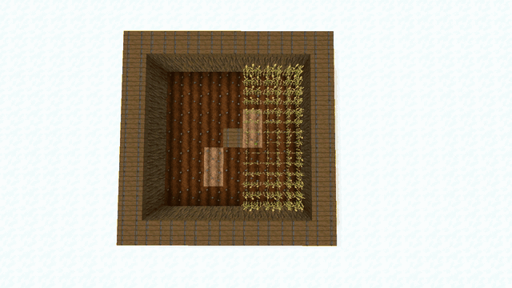
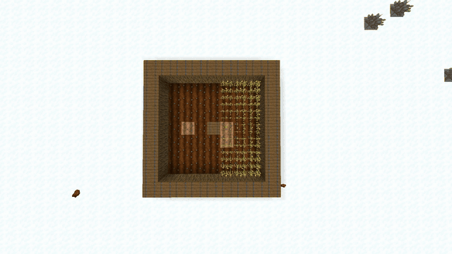
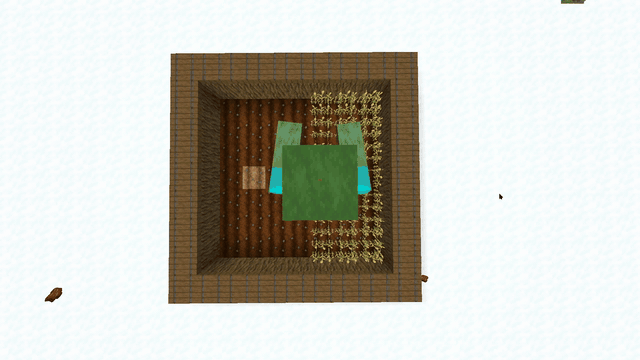
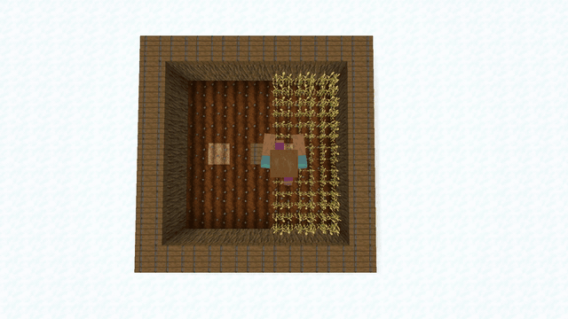
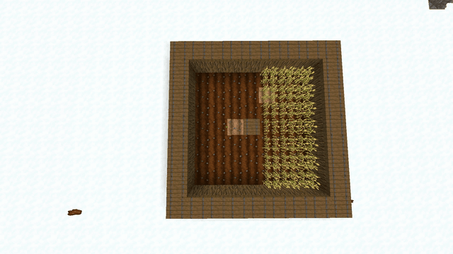

# No Crop Trample

A lightweight, **server-side only** mod for Fabric and NeoForge that prevents players and mobs from trampling farmland into dirt. Vanilla clients can join servers with nothing installed; installing the mod on the client is completely optional and adds a localized config screen (10 languages).

## Demo

The same test with each setting off and on.

| | Off | On |
|---|---|---|
| **Player** |  |  |
| **Mob** |  |  |
| **Empty farmland** |  |  |

Empty farmland protection only affects unplanted farmland; planted farmland follows the player and mob settings.

## Features

- **Independent toggles** for players, mobs, and empty (unplanted) farmland.
- **Mounted players follow player rules** — horses, camels, pigs, and other player-controlled mounts use player rules (including Feather Falling).
- **Optional survival balance:**
  - **Min Feather Falling (`0–4`)** — require boots with at least that Feather Falling level before player protection applies.
  - **Max Safe Fall Distance (`0–100` blocks, `0` = unlimited)** — keep normal jumps safe while letting high falls still trample farmland.
- **Zero tick overhead** — event-driven (a single Fabric Mixin / NeoForge's native `FarmlandTrampleEvent`), no tick loops or entity scanning.
- **100% server-side** — vanilla clients join without needing the mod.

## How Settings Work

- **In an active world (per-world GameRules):** Each world saves its own live settings as native Minecraft GameRules (`nocroptrample:*`). Change them anytime via `/nocroptrample`, `/gamerule`, Minecraft's **Game Rules** screen, or (in singleplayer) the mod's config screen. Different worlds can have different rules.
- **Defaults for new worlds (`config/nocroptrample.json`):** The JSON config file sets the starting values for newly created worlds — edit it by hand or from the **Title Screen** (via ModMenu on Fabric, or Mods → Config on NeoForge). To apply updated JSON defaults to an existing world, run `/nocroptrample reload`.
- **Multiplayer servers (optional client GUI):** Only the server needs the mod. Players who also install it on their client see the server's **live settings (read-only)** in the config screen (automatically updated when an OP changes a rule), or a clear notice on servers without the mod.

## Commands & GameRules

Viewing status works for everyone; changing settings requires OP permission level 2 (OPs also get clickable controls in `/nocroptrample status`).

| Setting | Default | Command | GameRule |
|---|---|---|---|
| Empty farmland | `true` | `/nocroptrample empty [on\|off]` | `nocroptrample:prevent_empty_trampling` |
| Players & mounts | `true` | `/nocroptrample player [on\|off]` | `nocroptrample:prevent_player_trampling` |
| Mobs | `true` | `/nocroptrample mob [on\|off]` | `nocroptrample:prevent_mob_trampling` |
| Min Feather Falling | `0` (off) | `/nocroptrample featherfalling [0-4]` | `nocroptrample:min_feather_falling_level` |
| Max safe fall | `0` (unlimited) | `/nocroptrample falldistance [0-100]` | `nocroptrample:max_safe_fall_distance` |

Utility commands:

- `/nocroptrample` or `/nocroptrample status` — show current world settings (with clickable toggles/steps for OPs).
- `/nocroptrample reload` — reload `config/nocroptrample.json` and apply those defaults to the current world.
- `/nocroptrample reset` — reset the current world's rules back to mod defaults.

## Default Configuration

`config/nocroptrample.json` seeds newly created worlds and `/nocroptrample reload` (existing worlds store their own overrides in GameRules):

```json
{
  "preventEmptyTrampling": true,
  "preventPlayerTrampling": true,
  "preventMobTrampling": true,
  "minFeatherFallingLevel": 0,
  "maxSafeFallDistance": 0
}
```

## Modpacks & Datapack Tags

| Tag | Path | Purpose |
|---|---|---|
| `#nocroptrample:protected_crops` | `data/nocroptrample/tags/block/protected_crops.json` | Extra blocks treated as planted crops (includes `minecraft:torchflower` by default; `CropBlock`, `StemBlock`, `AttachedStemBlock`, and `#minecraft:crops` are already detected automatically). |
| `#nocroptrample:trample_exempt_entities` | `data/nocroptrample/tags/entity_type/trample_exempt_entities.json` | Entities that never trample farmland. |
| `#nocroptrample:always_trample_entities` | `data/nocroptrample/tags/entity_type/always_trample_entities.json` | Entities that always trample farmland (takes priority over all protection rules, including `trample_exempt_entities`). |

Example datapack override (`data/nocroptrample/tags/entity_type/always_trample_entities.json`):

```json
{
  "replace": false,
  "values": [
    "minecraft:ravager"
  ]
}
```

## Requirements

- Minecraft 26.3+
- Fabric Loader 0.16+ and Fabric API, **or** NeoForge 26.3+
- Java 25+

## Links

- [GitHub](https://github.com/murqin/NoCropTrample)
- [Issues](https://github.com/murqin/NoCropTrample/issues)
