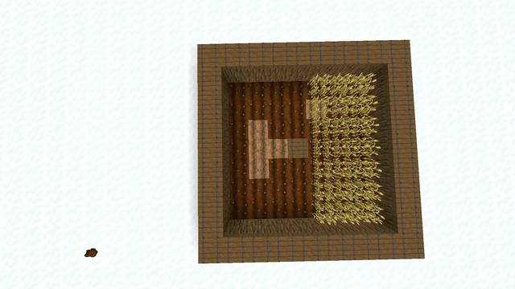

# No Crop Trample

A lightweight mod for Fabric and NeoForge that prevents farmland from being trampled and reverted to dirt when players or mobs land on it.

## Demo

The same test with each setting off and on.

| | Off | On |
|---|---|---|
| **Player** |  |  |
| **Mob** |  |  |
| **Empty farmland** |  |  |

Empty farmland protection only affects unplanted farmland; planted farmland follows the player and mob settings.

## Features

- Prevents farmland blocks from reverting to dirt when entities land on them (player-ridden mounts follow player rules).
- Player, mob, and empty (unplanted) farmland trampling can be toggled independently.
- Optional **Feather Falling requirement** (`0–4`) and **max safe fall distance** threshold (`0` = unlimited) for survival balance.
- Datapack tags for modpacks: `#nocroptrample:protected_crops` (includes `minecraft:torchflower` by default), `#nocroptrample:trample_exempt_entities`, and `#nocroptrample:always_trample_entities`.
- No tick handlers, no entity scanning — a Fabric Mixin on Fabric, a native event listener on NeoForge.
- Works server-side only; client install is completely optional (adds a localized config screen via ModMenu on Fabric or NeoForge's mod config button, and shows a read-only view of live server settings on multiplayer).

## Commands

Viewing status works for everyone; changing settings requires operator permission level 2.

| Command | Description |
|---------|-------------|
| `/nocroptrample status` | Show current settings (clickable controls for OPs). |
| `/nocroptrample empty [on\|off]` | View or toggle protection for empty farmland. |
| `/nocroptrample player [on\|off]` | View or toggle player trampling protection. |
| `/nocroptrample mob [on\|off]` | View or toggle mob trampling protection. |
| `/nocroptrample featherfalling [0-4]` | View or set minimum Feather Falling level (`0` = disabled). |
| `/nocroptrample falldistance [blocks]` | View or set max protected fall distance (`0` = unlimited). |
| `/nocroptrample reload` | Reload the config file from disk. |
| `/nocroptrample reset` | Reset all settings to defaults. |

## Configuration

Config file: `config/nocroptrample.json`

```json
{
  "preventEmptyTrampling": true,
  "preventPlayerTrampling": true,
  "preventMobTrampling": true,
  "minFeatherFallingLevel": 0,
  "maxSafeFallDistance": 0.0
}
```

## Requirements

- Minecraft 26.3+
- Fabric Loader 0.16+ and Fabric API, **or** NeoForge 26.3+
- Java 25+

## Links

- [GitHub](https://github.com/murqin/NoCropTrample)
- [Issues](https://github.com/murqin/NoCropTrample/issues)
