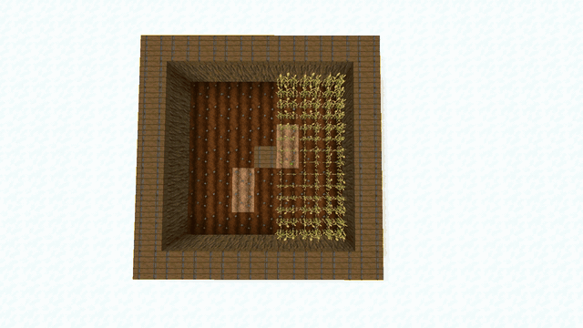
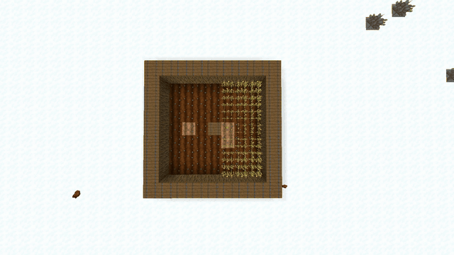
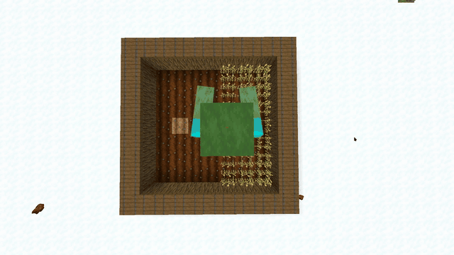
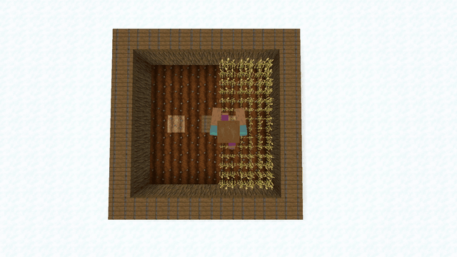
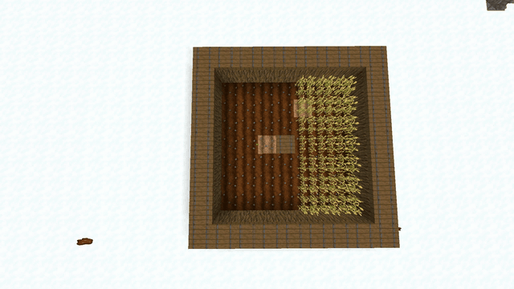
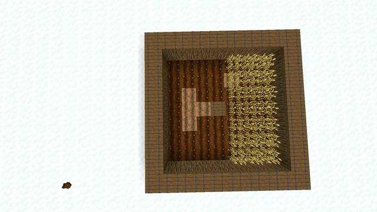

# No Crop Trample

> [!CAUTION]
> Developed with the help of AI coding agents. Bug reports and suggestions are welcome in [Issues](https://github.com/Murqin/NoCropTrample/issues).

A lightweight, server-side mod for Fabric and NeoForge that prevents farmland from being trampled by players or mobs.

[](#)
[](#)
[](LICENSE)
[](#)

## Demo

The same test with each setting off and on.

| | Off | On |
|---|---|---|
| **Player** |  |  |
| **Mob** |  |  |
| **Empty farmland** |  |  |

Empty farmland protection only affects unplanted farmland; planted farmland follows the player and mob settings.

## Features

- Stops farmland from reverting to dirt when a player or mob lands on it (including player-ridden mounts following player rules).
- Player, mob, and empty (unplanted) farmland trampling can be toggled independently via chat commands or the config file.
- **Optional survival balance options:**
  - **Feather Falling requirement** (`minFeatherFallingLevel`, `0–4`) — optionally require boots with Feather Falling for player protection.
  - **Max safe fall distance** (`maxSafeFallDistance`, in blocks; `0` = unlimited) — allow high falls to still trample farmland while protecting normal jumps.
- **Datapack tag support:**
  - `#nocroptrample:protected_crops` (includes `minecraft:torchflower` by default) for blocks that should count as planted crops.
  - `#nocroptrample:trample_exempt_entities` for entity types that never trample farmland.
  - `#nocroptrample:always_trample_entities` for entity types that always trample farmland.
- **No ticking or entity scanning** on either platform (a Fabric Mixin / a native NeoForge event), negligible overhead.
- **Works server-side only;** client install is completely optional.
  - On singleplayer/local worlds, the config screen (via ModMenu on Fabric, or NeoForge's built-in mod config screen) lets you edit settings locally and supports 10 languages.
  - On multiplayer servers, modded clients optionally receive a read-only view of the server's live settings (or a clear notice if the server doesn't use the mod).

## Installation

1. Install [Fabric Loader](https://fabricmc.net/use/) + [Fabric API](https://modrinth.com/mod/fabric-api), **or** [NeoForge](https://neoforged.net/).
2. Download the matching jar from [Modrinth](https://modrinth.com/mod/nocroptrample) — `nocroptrample-fabric-<version>.jar` or `nocroptrample-neoforge-<version>.jar`.
3. Place it in your server's `mods/` directory.

## Commands

Viewing status works for everyone; changing settings requires operator permission level 2 (OP status view includes clickable controls).

- `/nocroptrample` or `/nocroptrample status` — show current settings (clickable toggles/steps for OPs).
- `/nocroptrample empty [on|off]` — view or toggle protection for empty farmland.
- `/nocroptrample player [on|off]` — view or toggle player trampling protection.
- `/nocroptrample mob [on|off]` — view or toggle mob trampling protection.
- `/nocroptrample featherfalling [0-4]` — view or set minimum Feather Falling level (`0` = disabled).
- `/nocroptrample falldistance [blocks]` — view or set max protected fall distance (`0` = unlimited).
- `/nocroptrample reload` — reload the config file from disk.
- `/nocroptrample reset` — reset all settings to defaults.

## Configuration

Stored at `config/nocroptrample.json`:

```json
{
  "preventEmptyTrampling": true,
  "preventPlayerTrampling": true,
  "preventMobTrampling": true,
  "minFeatherFallingLevel": 0,
  "maxSafeFallDistance": 0.0
}
```

## Building from source

Requires JDK 25.

```bash
git clone https://github.com/murqin/NoCropTrample.git
cd NoCropTrample
./gradlew build
```

`./gradlew build` builds both platforms — the jars land in `fabric/build/libs/` and `neoforge/build/libs/`. Use `./gradlew :fabric:build` or `./gradlew :neoforge:build` to build just one.

## License

MIT — see [LICENSE](LICENSE).
